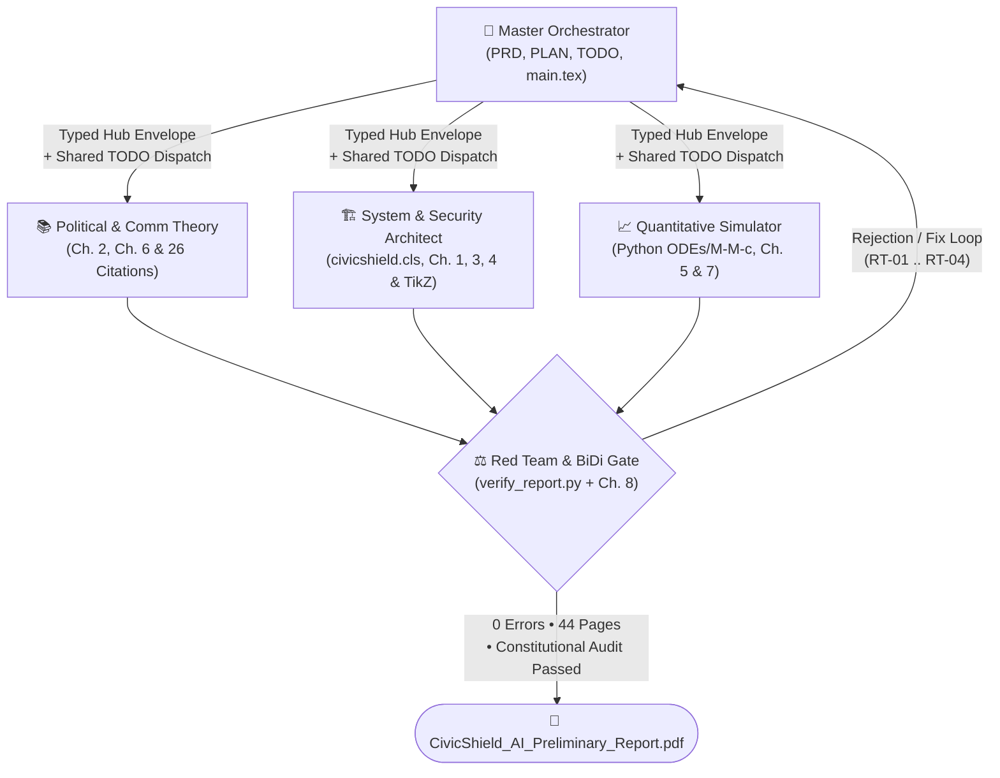
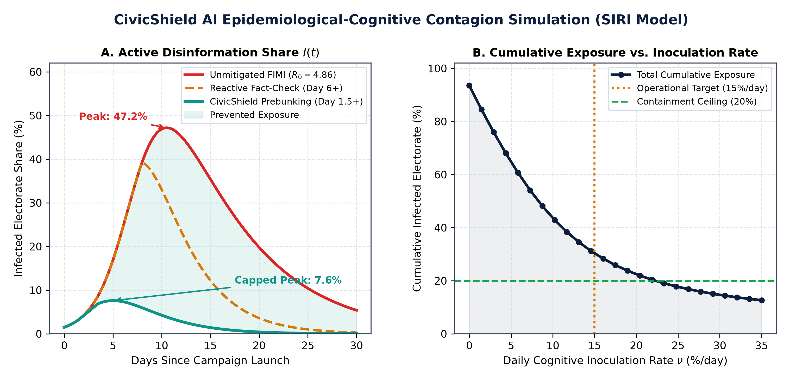
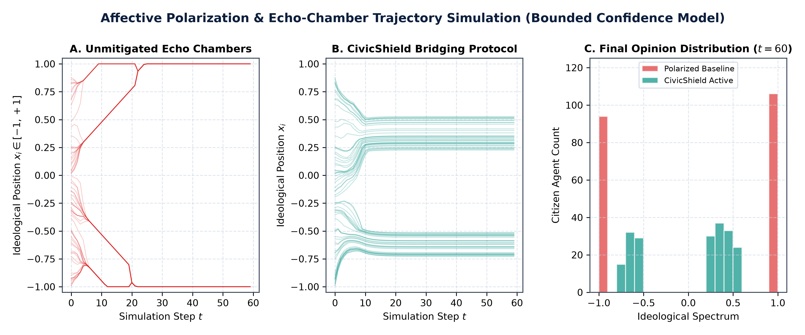
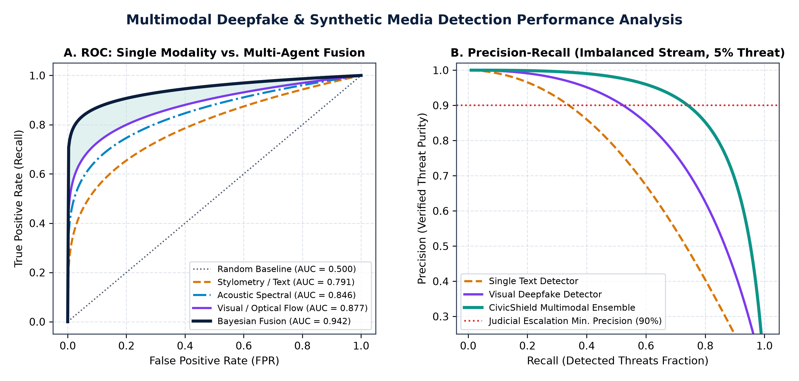
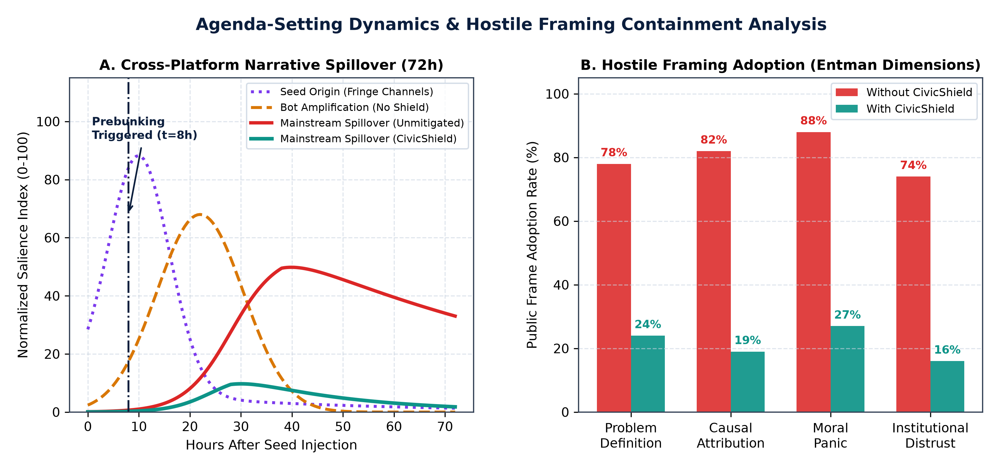
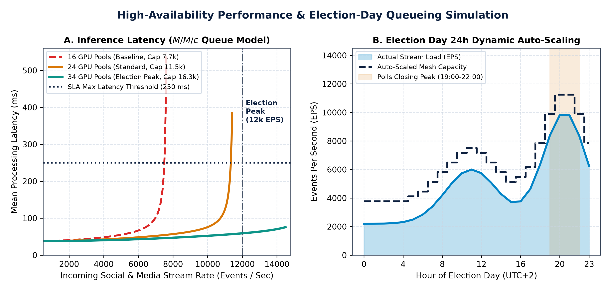
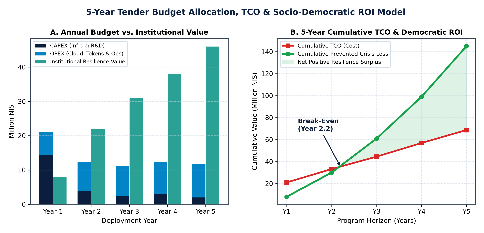

<div dir="rtl" align="center">

# 🛡️ CivicShield AI — מגן התודעה הלאומי
### דוח מכין אקדמי והנדסי (Preliminary Design Report) — מטלה 2

[-0B2545?style=for-the-badge&logo=adobeacrobatreader&logoColor=white)](./CivicShield_AI_Preliminary_Report.pdf)
[](./main.tex)
[](./scripts/generate_figures.py)
[](./team.json)

**סינתזה בין-תחומית: תקשורת פוליטית • מדעי המדינה ודמוקרטיה מתגוננת • הנדסת מערכות רב-סוכניות (Multi-Agent AI)**

</div>

> 🎓 **הקשר אקדמי:** פרויקט זה נכתב והופק במסגרת **מטלה 2** בקורס *יישומי בינה מלאכותית ו-Vibe Coding* בהנחיית **ד"ר יורם סגל** (אוניברסיטת חיפה), תוך יישום ישיר של מתודולוגיית **שיעור 4: Multi-Agent Orchestration** (`Master Orchestrator`, `Communication Hub`, `Shared TODO Board`, `Agent Inboxes`, `ReAct Loops` וצוות אדום לעומתי).

---

## 📌 תקציר הפרויקט (Executive Summary)

מערכות בחירות מודרניות ניצבות בפני מתקפות השפעה זרות מתואמות (**FIMI — Foreign Information Manipulation and Interference**), נחילי בוטים אוטונומיים, זיופי מדיה (**Deepfakes**) ושימוש ב"עוצמה חדה" (**Sharp Power**) החודרת אל המרחב הציבורי במהירות החורגת מיכולת התגובה של בדיקת עובדות בדיעבד (*Reactive Fact-Checking*).

**CivicShield AI ("מגן התודעה הלאומי")** הוא מפרט הנדסי-אקדמי למערכת לאומית רב-סוכנית (מענה למכרז ממשלתי משותף מדומיין של ועדת הבחירות המרכזית, מערך הסייבר הלאומי ומשרד המשפטים), המחברת בין **7 תיאוריות ליבה בתקשורת ובמדעי המדינה** לבין **ארכיטקטורה מבוזרת ב-5 שכבות, 4 מודלים מתמטיים ב-Python ומנגנון בלימה חוקתי קריפטוגרפי** — מבלי לאפשר לצנזורה אלגוריתמית אוטומטית להתקיים לעולם.

📄 **לצפייה בתוצר הסופי המלא (44 עמודים, מקומפל ב-LuaLaTeX ללא שגיאות):**  
👉 **[`CivicShield_AI_Preliminary_Report.pdf`](./CivicShield_AI_Preliminary_Report.pdf)**

---

## 📚 מסמכי הפרויקט (Project Governance & Documentation)

בהתאם למבנה ההנדסי ולמתודולוגיית הפעולה של הקורס, הפרויקט כולל תיעוד תכנון, ביצוע וביקורת מלא:

| מסמך | תפקיד במערכת | בעלים בוועדה |
| :--- | :--- | :--- |
| **[`CivicShield_AI_Preliminary_Report.pdf`](./CivicShield_AI_Preliminary_Report.pdf)** | הדוח המכין הסופי (44 עמודים, BiDi RTL, 6 גרפי Python, 6 איורי TikZ) | `master` + אינטגרציה |
| **[`PRD.md`](./PRD.md)** | מסמך דרישות המוצר: מפרט פונקציונלי, עקרונות ברזל חוקתיים וקריטריוני הצלחה | `master` |
| **[`PLAN.md`](./PLAN.md)** | תוכנית האדריכלות, שלבי הביצוע ההנדסיים ומיפוי המודלים | `master` |
| **[`TODO.md`](./TODO.md)** | לוח המשימות המשותף (*Shared TODO Board*) ומעקב השלמה | `master` |
| **[`AGY.md`](./AGY.md)** | פרוטוקול העבודה הראשי ואילוצי הסוכנים | כל הצוות |
| **[`team.json`](./team.json)** | הגדרת ועדת 5 הסוכנים, בעלות הקבצים ופרוטוקול התקשורת (*Hub JSON Envelope*) | ועדת הסוכנים |
| **[`agents/*/AGY.md`](./agents/)** | פרומפטים ייעודיים וכללי סמכות לכל אחד מ-5 הסוכנים (`master`, `theory`, `architect`, `simulator`, `redteam`) | כל סוכן בנפרד |

---

## 🤖 ארכיטקטורת ועדת הסוכנים (Multi-Agent Committee — Lecture 4)

במקום לנסות לייצר דוח מורכב בפרומפט מונוליטי יחיד (הסובל מזיהום הקשר, הזיות כמותיות וקונפליקט תפקידים), הפקת הדוח והמערכת עצמה תוכננו כ**ועדת מומחים מתואמת של 5 סוכנים**:



---

## ⚖️ שלושת עקרונות הברזל החוקתיים

1. **הפרדת רשויות בתוך הקוד (Zero Auto-Censorship):** לבינה המלאכותית אין סמכות למחוק פוסט, לחסום משתמש או להסיר ערוץ. תפקידה מתוחם לגילוי מתואם, חיזוי אפידמיולוגי והפקת הצעות ל**חיסון תודעתי ניטרלי (*Cognitive Prebunking*)**.
2. **חסינות דמוקרטית ושימור פלורליזם:** מודל הקיטוב משמר עוגן אותנטיות אישי של $0.28\, x_i(0)$ כדי למנוע קריסה מלאכותית של הדעות ל"קונצנזוס אחיד" (*Uniform Consensus Trap*).
3. **חתימה קריפטוגרפית משולשת (`3-of-3 Ed25519 Quorum`):** כל פנייה פורמלית לפלטפורמה בגין קמפיין FIMI חמור או Deepfake פלילי ננעלת חומרתית עד לאישור משולש של: (א) נציג שופט/ועדת בחירות, (ב) מערך הסייבר הלאומי, ו-(ג) איזון ציבורי-פרלמנטרי (אופוזיציה/מבקר).

---

## 🧠 סינתזה תיאורטית → רכיבי קוד ומודלים מתמטיים

| תיאוריה במדעי המדינה והתקשורת | תרגום אלגוריתמי ב-CivicShield AI | עוגן בדוח ובקוד |
| :--- | :--- | :--- |
| **קביעת סדר יום והתערבות בין-תקשורתית** (McCombs & Shaw) | ניטור זמן זליגה מטלגרם ו-X לזרם החדשות המרכזי (*Spillover Lead Time*) | פרקים 2, 3 • `fig4` |
| **פרדיגמת המסגור הפוליטי** (Entman) | פירוק טקסטים ל-4 ממדים: הגדרת בעיה, אשם, שיפוט מוסרי ופתרון | פרקים 2, 3 • `fig4` |
| **ספירלת השתיקה ותיבות תהודה** (Noelle-Neumann / Sunstein) | זיהוי מתקפת נחילי בוטים ($\Delta t < 2\text{s}$) המייצרים אשליית רוב מזויפת | פרקים 2, 4, 5 • `fig2` |
| **תיאוריית החיסון התודעתי** (McGuire / Roozenbeek & van der Linden) | הפצת אזהרה מוקדמת ודוגמאות טכניקה מוחלשות טרם חדירה מסיבית | פרקים 1, 2, 5 • `fig1` |
| **המרחב הציבורי ועוצמה חדה** (Habermas / Walker & Ludwig) | חשיפת מתקפות היברידיות בלי לפגוע בשיח אזרחי דליברטיבי | פרקים 2, 6 |
| **דמוקרטיה מתגוננת** (Loewenstein / בג"ץ 1/65 וברק) | עץ החלטות חוקתי קשיח (`OPA/Rego`), ופרטיות דיפרנציאלית ($\epsilon \le 1.2$) | פרק 6 • איור 6.1 |
| **קיטוב אפקטיבי ואיזון מערכתי** | הרחבת קשב עם משקל עוגן $0.28\, x_i(0)$ ובדיקות הגינות דו-מפלגתיות | פרקים 5, 6 • `fig2` |

---

## 📊 גלריית הסימולציות הכמותיות (`scripts/generate_figures.py`)

כל ששת הגרפים בדוח אינם איורים אילוסטרטיביים, אלא תוצר דטרמיניסטי של הרצת [`scripts/generate_figures.py`](./scripts/generate_figures.py):

### 1. דינמיקת הדבקה תודעתית וחיסון מוקדם (`SIRI ODEs` — Runge-Kutta 4)
במצב הבסיס של מתקפת בוטים ($\beta = 0.68\text{ day}^{-1}$, $\gamma = 0.14\text{ day}^{-1}$) מתקבל מקדם התרבות $R_0 \approx 4.86$ וסף חיסון קריטי $p_c \approx 79.4\%$. הפעלת **Prebunking** מוקדם (יום $1.5$, $\nu = 0.22\text{ day}^{-1}$) חותכת את שיא ההדבקה מ-**47.2%** ל-**7.6%** בלבד, וקצב $\nu = 15\%/\text{day}$ בולם את החשיפה המצטברת מתחת לתקרת ה-20%.



### 2. קיטוב תחומת-אמון וגישור פלורליסטי (`Hegselmann-Krause` + Rejection)
הרצת $N=200$ סוכני אזרחים מראה כיצד ללא התערבות ($\epsilon=0.22$, דחייה חוץ-קבוצתית $\delta_{\text{rep}}=0.03$) האוכלוסייה מתרוקנת מהמרכז לשני קטבים קיצוניים; מנגד, פרוטוקול הגישור של CivicShield ($\epsilon_{\text{eff}} = 0.402$, עוגן $0.28\, x_i(0)$) משמר התפלגות רחבה ומגוונת ללא אחידות כפויה.



### 3. איחוד ראיות בייסיאני לזיהוי Deepfake ובעיית שיעור הבסיס
איחוד הסתברויות log-odds על פני 4 אותות בלתי תלויים (`Stylometry`, `Acoustic`, `Visual`, `C2PA/Network`) מתגבר על מלכודת שיעור הבסיס ($P(F)=0.05$) ושומר על **Precision $\ge 90\%$** לאורך טווח פעולה רחב לפני הסלמה לחתימת שופט.



### 4. בלימת זליגת סדר היום והסטת המסגור (`Entman Dimensions`)
הזרקת חיסון תודעתי ממוקד ב-$t=8\text{h}$ בולמת את החדירה מתוך ערוצי טלגרם אל תקשורת הזרם המרכזי ומפחיתה משמעותית אימוץ מסגרות עוינות (`78%→24%`, `82%→19%`, `88%→27%`, `74%→16%`).



### 5. תכנון קיבולת והשהיה לליל הבחירות (`M/M/c Erlang-C Queueing`)
תחת עומס שיא של $\lambda_{\text{peak}} = 12,000\text{ EPS}$ (אירועים לשנייה) וקצב עיבוד $\mu = 480\text{ EPS/Pool}$, תצורת **34 GPU Pools** (קיבולת $16.3\text{k EPS}$) מבטיחה עמידה בתקרת **$< 250\text{ ms}$** עם סך מסלול קריטי של **$238\text{ ms}$**.



### 6. מודל תקציב חמש-שנתי (`CAPEX/OPEX`) והחזר השקעה מוסדי (`ROI`)
פריסת תקציב של **68.7 מיליון ש"ח (TCO)** על פני 5 שנים ($26.0\text{M}$ CAPEX ו-$42.7\text{M}$ OPEX) מול ערך חוסן מצטבר של **145.0 מיליון ש"ח**, עם נקודת איזון כלכלית (**Break-Even**) בשנה **2.2**.



---

## 🗂️ מבנה המאגר (Repository Structure)

```text
CivicShield-AI-Project2/
├── CivicShield_AI_Preliminary_Report.pdf  # 📄 הדוח המכין הסופי (44 עמודים)
├── civicshield.cls                        # 🎨 מחלקת LaTeX מותאמת (BiDi RTL, tcolorbox, TikZ)
├── main.tex                               # 📘 קובץ ראשי, דף שער ב-TikZ וביבליוגרפיה (26 מקורות)
├── chapters/                              # 📑 8 פרקים מודולריים
│   ├── ch01_executive_rfp.tex             # פרק 1: תקציר מנהלים, רקע המכרז ו-CONOPS
│   ├── ch02_theory_comm_poli.tex          # פרק 2: תשתית תיאורטית (תקשורת ומדעי המדינה)
│   ├── ch03_requirements_usecases.tex     # פרק 3: דרישות FR/NFR, תרחישי ייחוס וגרף מסגור
│   ├── ch04_architecture_agents.tex       # פרק 4: ארכיטקטורה 5-שכבתית, ReAct ו-Hub Envelope
│   ├── ch05_math_models_simulations.tex   # פרק 5: פיתוחים מתמטיים (SIRI, H-K, Bayes, Erlang-C)
│   ├── ch06_ethics_law_regulation.tex     # פרק 6: משפט חוקתי, דמוקרטיה מתגוננת, Quorum ו-DP
│   ├── ch07_risks_roadmap_budget.tex      # פרק 7: סיכונים, גאנט 24 חודשים (TikZ) ותקציב
│   └── ch08_multiagent_methodology.tex    # פרק 8: מתודולוגיית ועדת הסוכנים ויומן צוות אדום
├── scripts/
│   ├── generate_figures.py                # 🐍 מחולל דטרמיניסטי של 6 גרפי PDF + PNG
│   └── verify_report.py                   # ✅ סקריפט QA אוטומטי (עמודים, לוג LuaLaTeX וקבצים)
├── figures/                               # 📊 6 גרפים וקטוריים (.pdf) ו-6 תמונות (.png)
├── agents/                                # 🤖 תיקיות הסוכנים והוראות התפקיד (Lecture 4)
│   ├── master/AGY.md
│   ├── theory/AGY.md
│   ├── architect/AGY.md
│   ├── simulator/AGY.md
│   └── redteam/AGY.md
├── team.json                              # 🔗 מטא-דאטה של ועדת הסוכנים ובעלות קבצים
├── AGY.md                                 # 🧭 כללי הפרויקט ואילוצי ההפקה
├── PRD.md                                 # 📋 מסמך דרישות המוצר
├── PLAN.md                                # 🛠️ תוכנית עבודה וארכיטקטורה
├── TODO.md                                # ☑️ לוח משימות ומעקב ביצוע
├── .gitignore                             # 🧹 סינון קובצי ביניים (.aux/.log/.toc)
└── README.md                              # 📖 מסמך תיעוד זה
```

---

## ⚙️ הרצה ושחזור מקומי (Reproduction Guide)

ניתן לשחזר את כל הגרפים, לקמפל מחדש את הדוח ב-LuaLaTeX ולהריץ את בדיקות האימות המלאות באופן מקומי:

### 1. יצירת הגרפים המדעיים ב-Python (`uv`)
```powershell
uv run --with matplotlib --with numpy python scripts/generate_figures.py
```

### 2. קומפילציה של הדוח המלא ב-LuaLaTeX (שני מעברים לסנכרון תוכן עניינים והפניות)
```powershell
lualatex --disable-installer -interaction=nonstopmode -jobname=CivicShield_AI_Preliminary_Report main.tex
lualatex --disable-installer -interaction=nonstopmode -jobname=CivicShield_AI_Preliminary_Report main.tex
```

### 3. הרצת חבילת האימות האוטומטית (`verify_report.py`)
```powershell
uv run --with pypdf python scripts/verify_report.py
```
**פלט צפוי:**
```text
=== CivicShield AI Verification Suite ===
PDF File       : CivicShield_AI_Preliminary_Report.pdf (907,502 bytes)
PDF Page Count : 44 pages (Accepted range: 37-45)
LaTeX Errors(!): 0
BiDi Lua Errors: 0
Undefined Refs : 0
Undefined Cites: 0
Rerun Warnings : 0

VERIFICATION PASSED: All checks clean!
```

---

## ✍️ מחבר והגשה (Author)

* **מגיש הפרויקט:** `ShmuelTetroashvili`
* **מוסד:** אוניברסיטת חיפה — קורס *יישומי AI ו-Vibe Coding* (ד"ר יורם סגל)
* **רישיון שימוש:** מוגש כעבודת מחקר ותכנון אקדמית-הנדסית במסגרת מטלה 2.
